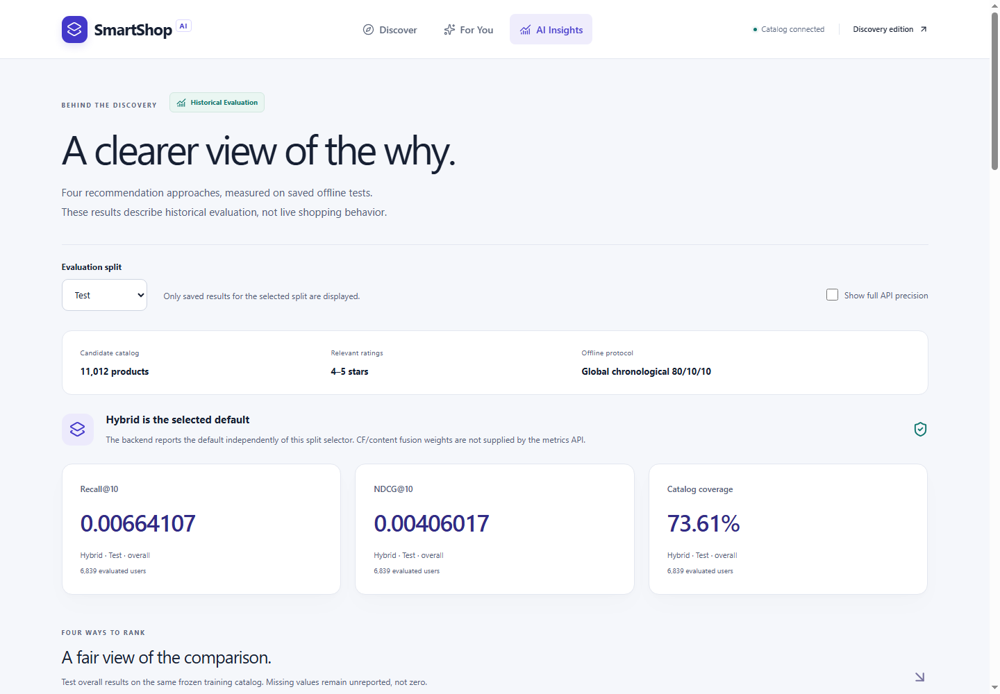
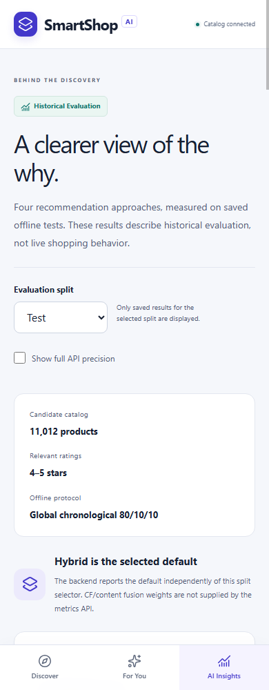
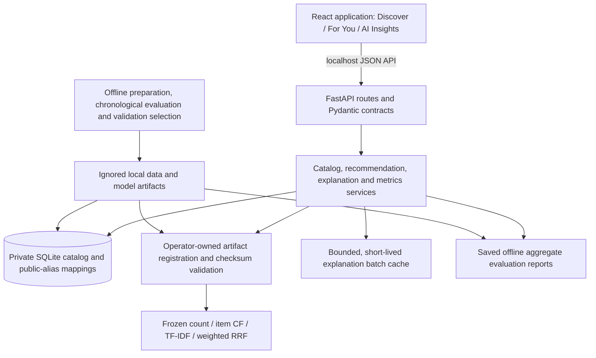

# SmartShop-AI

**Explainable AI-powered electronics discovery with collaborative, content-based, and hybrid recommendations.**

SmartShop-AI connects a React product-discovery interface to a FastAPI recommendation
engine for Cell Phones & Accessories. Browse verified product metadata, explore
personalized top-10 picks, inspect their supporting evidence, and compare four
recommendation approaches on saved historical evaluations.

Built as an intermediate-level portfolio application, it runs locally with frozen
models and anonymous demo profiles. Product discovery and recommendation evaluation
are its scope; checkout, payments, inventory and live preference learning are not
implemented.

## Explore the application

- **Discover:** server-side search, category filters, pagination and product details
  sourced from verified local metadata. Similar products use TF-IDF content features.
- **For You:** select one of 12 anonymous historical profiles, compare Hybrid,
  Content, CF and Popularity, and inspect why each product was recommended.
- **Cold-start demo:** explicitly create a new local identity to see frozen
  popularity recommendations without an existing rating history.
- **AI Insights:** compare saved validation/test metrics, warm/cold segments and
  history buckets through accessible charts and equivalent tables.
- **Responsive interaction:** mobile navigation, keyboard-accessible explanation
  dialogs, reduced-motion support, loading/empty states and request recovery.

## Interface preview

These reviewed captures show the real **Historical Evaluation** interface and
aggregate saved results. No product titles, user identities or private paths appear.



<details>
<summary>Mobile interface</summary>



</details>

See the [screenshot review](docs/portfolio_publication.md#screenshot-review) for
scope and exclusions. Screenshots document a local application, not a hosted demo.

## Technology

| Layer | Technologies |
|---|---|
| Interface | React, Vite, Tailwind CSS, React Router, Recharts, Lucide |
| API | FastAPI, Pydantic v2, Uvicorn, HTTPX |
| Recommendation engine | Python, NumPy, SciPy sparse matrices, scikit-learn |
| Local storage and acquisition | SQLite, DuckDB, metered HTTP range requests |
| Verification | unittest, Vitest, React Testing Library, local Chrome smoke checks |

Dependency versions are pinned in the Python requirement files and
[frontend/package-lock.json](frontend/package-lock.json). The tested environment is
Windows x64, Python 3.14.7 and project-local Node.js 26.13.1 / npm 11.20.0.

## Architecture



The backend loads trusted artifacts after provenance checks; serving does not train
models. One Uvicorn worker and serialized inference keep recommendation evidence
consistent. Batch-bound explanations expire rather than persisting private traces
in the browser. See [backend architecture](docs/backend_architecture.md) and
[frontend architecture](docs/frontend_architecture.md).

## Dataset and preparation

Source: **Amazon Reviews 2023**, Cell Phones & Accessories, McAuley Lab, UC San Diego.
The inspected five-core ratings input contains 2,752,785 interactions. Deterministic
SHA-256 user sampling with seed 42 and iterative distinct-neighbor graph pruning
produced the manageable subset:

| Prepared resource | Size |
|---|---:|
| Rating interactions | 171,104 |
| Historical users | 25,791 |
| Products available for browsing | 12,635 |
| Training-observed recommendation candidates | 11,012 |
| Browse-only products outside the frozen catalog | 1,623 |

Ratings retain their original 1–5 values and timestamps; products join metadata
through `parent_asin`. Bounded acquisition at immutable Hugging Face revision
`2b6d039ed471f2ba5fd2acb718bf33b0a7e5598e` matched every selected product. There are
12,634 usable titles, and every product has usable text in a category field. Only
IDs, titles, main categories and category hierarchies were acquired.

**Raw datasets, downloaded product metadata/text, generated model artifacts,
private demo mappings and local databases are not distributed.** They remain in
ignored local storage; the original ratings CSV stays outside the checkout.
See [data usage and attribution](docs/data_usage.md).

## Recommendation methods and evidence

| Method | Frozen configuration and behavior |
|---|---|
| Popularity | Training interaction-count ranking; also the shared fallback |
| Item-based collaborative filtering | Positive cosine similarity, at least two shared positive users, K=50 neighbors and shrinkage lambda=10 |
| Content-based filtering | Separate title/category unigram–bigram TF-IDF, float32 sparse features, min_df=2, title weight 0.80 |
| **Hybrid — selected default** | **50% CF ranking weight, 50% content ranking weight; weighted Reciprocal Rank Fusion with rank constant 60** |

CF and content profiles use only training products rated 4–5 stars. All ratings
remain seen-item exclusions; lower ratings do not become positive preference seeds.
Sparse calculations avoid a full dense product-product similarity matrix.

For available component ranks, the hybrid sums `weight / (60 + rank)`, using
one-based ranks. Missing component signals cause per-user weight normalization.
Only positive personalized signals enter fusion; count popularity fills remaining
slots once, after fusion. Ranking values are neither probabilities nor confidence
percentages.

Explanations use actual inference evidence: supporting training-liked products,
shared TF-IDF terms, component ranks and fusion contributions, or an explicit
popularity fallback reason. Evidence is shown only when supplied by the engine.

Historical demo profiles privately map public aliases to real training histories;
raw dataset user IDs are not exposed. New local demo identities have no such
history and receive count popularity. Browsing does not update either profile's
preferences. Online demonstrations use **training-only histories**, while the
offline test protocol additionally excludes validation-seen products.

## Historical evaluation

The existing global chronological split preserves equal timestamps:
**136,883 training / 17,110 validation / 17,111 test interactions** (approximately
80/10/10). Scores, similarity statistics and profiles use training data only;
TF-IDF vocabulary/IDF fit only the training catalog. Validation NDCG@10 selects
configurations, and the selected default is frozen before test evaluation.

All models rank the full 11,012-product training catalog without sampled negatives.
Seen-item filtering uses training for validation, and training plus validation for
test, without updating scores. Ratings of 4–5 are binary relevant targets. Cold
products remain in evaluation denominators even though they cannot be recommended.

### Frozen test comparison

| Model | Recall@10 | NDCG@10 | Catalog coverage@10 |
|---|---:|---:|---:|
| Popularity | 0.00345062 | 0.00195011 | 0.14% |
| Collaborative filtering | 0.00494735 | 0.00300261 | 30.57% |
| Content-based filtering | 0.00585148 | 0.00363137 | 77.37% |
| **Hybrid** | **0.00664107** | **0.00406017** | **73.61%** |

These saved overall metrics use **6,839 users with relevant test targets**. Recall
measures how many of their relevant products appear in the top ten; NDCG also
rewards earlier relevant results. Both are macro-averaged per user. Coverage is the
distinct recommended products across that same cohort divided by the training
catalog. Values above are rounded for display; saved reports retain full precision.

Validation NDCG@10 was 0.00389604 for count, 0.00657693 for CF, 0.00768907 for
content and **0.00833246 for the selected hybrid** (7,779 positive-target users).
The hybrid passed the strict validation improvement gate over content (+8.37%).
Its test NDCG@10 is 11.81% above content, while coverage falls by 3.76 percentage
points. These are descriptive point estimates, not significance or online-benefit
claims.

The hybrid supplied personalized recommendations to 88.70% of all test-window users;
popularity filled 11.30% of recommendation slots. These usage rates include users
without positive targets and therefore use a different cohort from ranking metrics.
Full segments and comparisons: [evaluation protocol](docs/evaluation_strategy.md),
[popularity](docs/baseline_report.md), [CF](docs/item_cf_report.md),
[content](docs/content_report.md), [hybrid](docs/hybrid_report.md).

### Interpretation and limitations

- Absolute offline retrieval metrics are low; this is a sparse, static historical
  benchmark, not a measure of live shopping accuracy or purchase likelihood.
- Five-core sampling/pruning was retrospective and uses future graph activity.
  Chronological training does not undo that selection bias or guarantee training coverage.
- Metadata may postdate the training cutoff; historical title/category availability
  is unknown even though TF-IDF fitting is restricted to training products.
- The frozen catalog excludes 1,623 browseable products. Cold-product target segments
  have zero hits; only 40.98% of positive test targets are catalog-reachable.
- Validation was reused across component and fusion selection. No uncertainty
  intervals or causal/online experiments were performed.
- This is an unauthenticated localhost demo. Modern Chrome/mobile emulation was
  checked; physical devices and a full screen-reader audit were not verified.

## Run locally

**A source clone alone cannot start the complete application.** Follow
[fresh-clone setup](docs/fresh_clone_setup.md) for dependencies, project-local Node,
lawful data acquisition, new artifact rebuilding, provenance registration and SQLite
preparation. A full fresh-clone end-to-end rebuild has **not** been verified.

For an already prepared workspace, run from the project root in two terminals:

```powershell
# Terminal 1: FastAPI, one worker on loopback
.\.venv\Scripts\python.exe -B -m backend
```

```powershell
# Terminal 2: React, using the project-local Node/npm toolchain
.\.venv\Scripts\python.exe -B scripts/frontend.py dev
```

Open **http://localhost:5173**; API docs: **http://127.0.0.1:8000/docs**.
See [local setup and troubleshooting](docs/local_setup.md) for build preview and
readiness checks. Startup never downloads data or retrains models.

## Tests and QA

Latest recorded regression results: **196 Python tests**, **97 frontend tests** and
a successful production build. Final frontend QA recorded **57 browser-flow groups**
and **20 page/viewport checks** across 320, 390, 768, 1024 and 1440 px. The subsequent
publication-hardening check preserved all 111 protected file hashes and passed 14
additional browser-flow checks. These are scoped local checks, not accessibility
certification or production load testing.

```powershell
.\.venv\Scripts\python.exe -B -m unittest discover -s tests -v
.\.venv\Scripts\python.exe -B scripts/frontend.py test
.\.venv\Scripts\python.exe -B scripts/frontend.py build
```

The complete suite includes frozen-artifact integration tests and needs private
prepared resources. See [final UI QA](docs/final_qa_report.md) and
[publication-hardening verification](docs/publication_step38_report.md) for dated
measurements and limitations. No tests were rerun for this documentation-only step.

## Project map

```text
backend/       Routes, schemas, services and repositories
frontend/      Feature-oriented React application
scripts/       Data preparation, evaluation and frozen-model inference
tests/         Python unit and integration tests
docs/          Architecture, reports, setup and usage notes
data/local/    Private generated resources; ignored and not distributed
```

## Attribution and licensing status

Dataset: **Amazon Reviews 2023**, **McAuley Lab, UC San Diego**.
Citation: **Hou et al. (2024), Bridging Language and Items for Retrieval and
Recommendation**, [arXiv:2403.03952v1](https://arxiv.org/abs/2403.03952v1).
See the [official dataset site](https://amazon-reviews-2023.github.io/) and
[data-usage document](docs/data_usage.md) for the source snapshot, citation and
unresolved redistribution rights. SmartShop-AI is an independent portfolio project,
not an Amazon service or endorsement.

Original source code and documentation owned by, or authorized for licensing by,
Laiba Nadeem are covered by the [MIT License](LICENSE), copyright 2026 Laiba Nadeem.
Third-party material retains its own terms; see [third-party notices](THIRD_PARTY_NOTICES.md).
The repository's MIT License grants no rights to Amazon Reviews 2023, external
datasets, product metadata, generated model artifacts or other third-party content.
Those local data/model resources are not distributed. See
[publication preparation](docs/portfolio_publication.md) and the
[final safety review](docs/publication_safety_review.md) for screenshot review,
repository description/topics and remaining publication checks.
